# Jarkom-Modul-5-2026-K-19

## Anggota Kelompok

| Nama | NRP |
| --- | --- |
| Ni Putu Maqueenta Wijaya | 5027251004 |
| Malikha Syafira Dewi | 5027251032 |

## Pembahasan

## Soal 1. Pembagian alamat dengan VLSM

Prefix kelompok `10.73.0.0/16` dibagi untuk 17 LAN dan 16 link antar-router, sehingga totalnya 33 subnet. Subnet diurutkan dari kebutuhan host terbesar ke terkecil, lalu setiap segmen mendapat prefix terkecil yang masih memuat kebutuhan tersebut.

Sebagai contoh perhitungan, segmen Lab menampung Entry-Plug, Dummy-Plug, dan gateway Ritsuko, jadi butuh 3 alamat host. Jumlah host yang bisa dipakai adalah `2^n - 2`, sehingga `2^2 - 2 = 2` alamat belum cukup dan `2^3 - 2 = 6` alamat cukup. Prefix yang dipakai adalah `32 - 3 = 29`, jadi segmennya `10.73.4.32/29` dengan gateway `10.73.4.33` dan broadcast `10.73.4.39`, menyisakan 3 alamat.

**17 LAN**

| Subnet | Prefix | Gateway | Broadcast | IP terpakai | Sisa |
| --- | --- | --- | --- | --- | --- |
| Quarters (Rei) | `10.73.0.0/23` | `10.73.0.1` | `10.73.1.255` | `.1`, `.2` | 508 |
| Comm-Net (Hikari) | `10.73.2.0/24` | `10.73.2.1` | `10.73.2.255` | `.1`, `.2` | 252 |
| Hangar-Crew (Yui) | `10.73.3.0/25` | `10.73.3.1` | `10.73.3.127` | `.1`, `.2` | 124 |
| Sachiel (Kensuke) | `10.73.3.128/26` | `10.73.3.129` | `10.73.3.191` | `.129`, `.130` | 60 |
| Medic-Bay (Maya) | `10.73.3.192/27` | `10.73.3.193` | `10.73.3.223` | `.193`, `.194`, `.195` | 27 |
| Relay-Node (Kaworu) | `10.73.3.224/27` | `10.73.3.225` | `10.73.3.255` | `.225`, `.226` | 28 |
| Garden-Staff (Shinji) | `10.73.4.0/28` | `10.73.4.1` | `10.73.4.15` | `.1`, `.2` | 12 |
| Dock-Crew (Mari) | `10.73.4.16/28` | `10.73.4.17` | `10.73.4.31` | `.17`, `.18` | 12 |
| Lab (Ritsuko) | `10.73.4.32/29` | `10.73.4.33` | `10.73.4.39` | `.33`, `.34`, `.37` | 3 |
| Terminal/MAGI (Fuyutsuki) | `10.73.4.40/29` | `10.73.4.41` | `10.73.4.47` | `.41` sampai `.44` | 2 |
| Cage (Misato) | `10.73.4.48/29` | `10.73.4.49` | `10.73.4.55` | `.49` sampai `.52` | 2 |
| Dogma (Toji) | `10.73.4.56/29` | `10.73.4.57` | `10.73.4.63` | `.57` sampai `.59` | 3 |
| Monolith (Shigeru) | `10.73.4.64/29` | `10.73.4.65` | `10.73.4.71` | `.65` sampai `.67` | 3 |
| Radar-Array (Makoto) | `10.73.4.72/29` | `10.73.4.73` | `10.73.4.79` | `.73`, `.74` | 4 |
| Archive-Vault (Asuka) | `10.73.4.80/30` | `10.73.4.81` | `10.73.4.83` | `.81`, `.82` | 0 |
| Intel (Kaji) | `10.73.4.84/30` | `10.73.4.85` | `10.73.4.87` | `.85`, `.86` | 0 |
| Tokyo3-Core (Gendou) | `10.73.4.88/30` | `10.73.4.89` | `10.73.4.91` | `.89`, `.90` | 0 |

**16 link antar-router**

| Link | Prefix | Ujung A | Ujung B |
| --- | --- | --- | --- |
| Gendou ke Shigeru | `10.73.4.92/30` | `10.73.4.93` | `10.73.4.94` |
| Gendou ke Asuka | `10.73.4.96/30` | `10.73.4.97` | `10.73.4.98` |
| Gendou ke Fuyutsuki | `10.73.4.100/30` | `10.73.4.101` | `10.73.4.102` |
| Gendou ke Kaji | `10.73.4.104/30` | `10.73.4.105` | `10.73.4.106` |
| Gendou ke Yui | `10.73.4.108/30` | `10.73.4.109` | `10.73.4.110` |
| Gendou ke Misato | `10.73.4.112/30` | `10.73.4.113` | `10.73.4.114` |
| Gendou ke Hikari | `10.73.4.116/30` | `10.73.4.117` | `10.73.4.118` |
| Asuka ke Kensuke | `10.73.4.120/30` | `10.73.4.121` | `10.73.4.122` |
| Asuka ke Ritsuko | `10.73.4.124/30` | `10.73.4.125` | `10.73.4.126` |
| Fuyutsuki ke Toji | `10.73.4.128/30` | `10.73.4.129` | `10.73.4.130` |
| Fuyutsuki ke Maya | `10.73.4.132/30` | `10.73.4.133` | `10.73.4.134` |
| Yui ke Shinji | `10.73.4.136/30` | `10.73.4.137` | `10.73.4.138` |
| Yui ke Rei | `10.73.4.140/30` | `10.73.4.141` | `10.73.4.142` |
| Yui ke Mari | `10.73.4.144/30` | `10.73.4.145` | `10.73.4.146` |
| Hikari ke Kaworu | `10.73.4.148/30` | `10.73.4.149` | `10.73.4.150` |
| Shigeru ke Makoto | `10.73.4.152/30` | `10.73.4.153` | `10.73.4.154` |

**Pohon IP**

```
10.73.0.0/16
|-- 10.73.0.0/23    Quarters                 510 host
|-- 10.73.2.0/24    Comm-Net                 254 host
|-- 10.73.3.0/25    Hangar-Crew              126 host
|-- 10.73.3.128/26  Sachiel                   62 host
|-- 10.73.3.192/27  Medic-Bay / Pen-Pen       30 host
|-- 10.73.3.224/27  Relay-Node                30 host
|-- 10.73.4.0/28    Garden-Staff              14 host
|-- 10.73.4.16/28   Dock-Crew                 14 host
|-- 10.73.4.32/29   Lab (Dummy-Plug)           6 host   <-- awal jalur
|-- 10.73.4.40/29   Terminal / MAGI            6 host
|-- 10.73.4.48/29   Cage (Unit-00/01/02)       6 host
|-- 10.73.4.56/29   Dogma (Lilith/Adam)        6 host
|-- 10.73.4.64/29   Monolith (Armisael)        6 host   <-- akhir jalur
|-- 10.73.4.72/29   Radar-Array                6 host
|-- 10.73.4.80/30   Archive-Vault              2 host
|-- 10.73.4.84/30   Intel / Spy                2 host
|-- 10.73.4.88/30   Tokyo3-Core                2 host
`-- 10.73.4.92/28   16 link /30 antar-router
```

Jalur Dummy-Plug ke Armisael melewati lima router:

```
Dummy-Plug 10.73.4.37
  -> Ritsuko 10.73.4.33 (Lab 10.73.4.32/29)
  -> link 10.73.4.124/30, Asuka 10.73.4.125
  -> link 10.73.4.96/30, Gendou 10.73.4.97
  -> link 10.73.4.92/30, Shigeru 10.73.4.94 dan 10.73.4.65
  -> Armisael 10.73.4.67 (Monolith 10.73.4.64/29)
```

Rencana ini sudah diperiksa ulang, 33 blok berada di dalam `10.73.0.0/16`, tidak ada yang bertumpuk, dan semua host masih tertampung. Total alamat terpakai 1.180 dari 65.536 alamat.

## Soal 2. Konfigurasi alamat dan IP forwarding

Gendou berada di puncak dengan delapan antarmuka. `eth0` mengarah ke NAT1 dan memakai DHCP, sedangkan `eth1` sampai `eth8` mengarah ke cabang Shigeru, Asuka, Fuyutsuki, Kaji, Yui, Misato, dan Hikari. Router lain dan semua host memakai alamat statis sesuai tabel soal 1. IP forwarding diaktifkan di seluruh router.

```bash
# Gendou (/etc/network/interfaces)
auto eth0
iface eth0 inet dhcp

auto eth1
iface eth1 inet static
    address 10.73.4.89
    netmask 255.255.255.252

auto eth2
iface eth2 inet static
    address 10.73.4.93
    netmask 255.255.255.252

auto eth3
iface eth3 inet static
    address 10.73.4.97
    netmask 255.255.255.252

auto eth4
iface eth4 inet static
    address 10.73.4.101
    netmask 255.255.255.252

auto eth5
iface eth5 inet static
    address 10.73.4.105
    netmask 255.255.255.252

auto eth6
iface eth6 inet static
    address 10.73.4.109
    netmask 255.255.255.252

auto eth7
iface eth7 inet static
    address 10.73.4.113
    netmask 255.255.255.252

auto eth8
iface eth8 inet static
    address 10.73.4.117
    netmask 255.255.255.252

up sysctl -w net.ipv4.ip_forward=1
```

Pola yang sama dipakai untuk router cabang dan router ujung, dengan alamat link sesuai tabel. Berkas lengkapnya ada di [`src/soal_2.sh`](./src/soal_2.sh). Berikut contoh konfigurasi host dan pengujian antarmuka.

```bash
# Quarters
auto eth0
iface eth0 inet static
    address 10.73.0.2
    netmask 255.255.254.0
    gateway 10.73.0.1

# Gendou
ip -br a
ping -c 2 10.73.4.94    # Shigeru
ping -c 2 10.73.4.98    # Asuka
ping -c 2 10.73.4.102   # Fuyutsuki
ping -c 2 10.73.4.106   # Kaji
ping -c 2 10.73.4.110   # Yui
ping -c 2 10.73.4.114   # Misato
ping -c 2 10.73.4.118   # Hikari

# Ujung bawah tiap link
Shigeru:~# ping -c 2 10.73.4.154
Hikari:~# ping -c 2 10.73.4.150
Yui:~# ping -c 2 10.73.4.138
```

`ip -br a` menunjukkan delapan antarmuka internal Gendou dengan prefix `/30`, sesuai tabel link. Ping ke `.102`, `.106`, `.110`, `.114`, `.118`, lalu ping Shigeru ke Makoto, Hikari ke Kaworu, dan Yui ke Shinji semuanya dijawab 2 dari 2 paket. Ping host ke gateway juga berhasil, misalnya Quarters ke `10.73.0.1` dan Comm-Net ke `10.73.2.1`.

Ping Gendou ke Tokyo3-Core `10.73.4.90` pada tangkapan layar dijawab `Destination Host Unreachable from 10.73.4.89`. Saat itu node Tokyo3-Core belum dijalankan sehingga ARP tidak terjawab. Setelah node aktif, layanannya bisa diakses seperti terbukti pada soal 8.

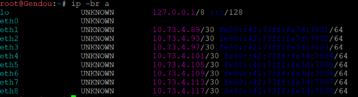
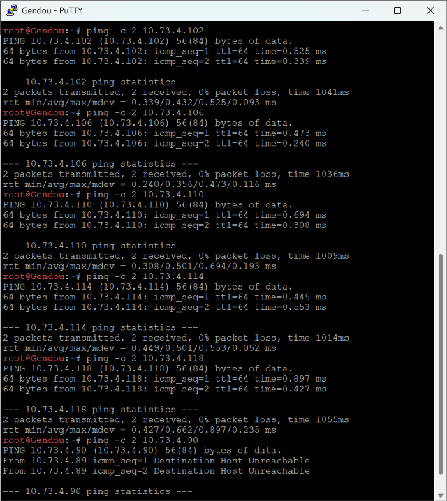
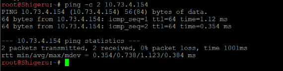
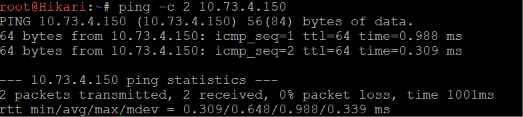
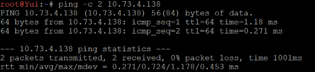
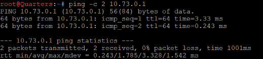
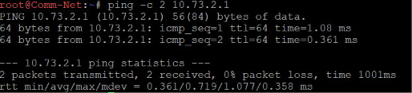

## Soal 3. Routing statis dengan jumlah rute minimum

Topologi disusun berlapis, jadi routing dibuat mengikuti lapisan tersebut. Router selain Gendou hanya punya satu default route ke atas ditambah rute ke subnet di bawahnya, sehingga router ujung tidak perlu tahu subnet di cabang lain. Gendou memakai default route ke NAT1 dan rute statis per cabang.

Beberapa subnet yang bersebelahan bisa digabung tepat menjadi satu CIDR. Garden `10.73.4.0/28` dan Dock `10.73.4.16/28` di cabang Yui membentuk `10.73.4.0/27`. Monolith `10.73.4.64/29` dan Radar `10.73.4.72/29` membentuk `10.73.4.64/28`. Subnet lain tidak bisa digabung tanpa ikut mencakup cabang tetangga, misalnya Terminal `10.73.4.40/29` dan Dogma `10.73.4.56/29` akan menelan Cage `10.73.4.48/29` bila digabung menjadi `10.73.4.40/28`.

**Default route router non-Gendou**

| Router | Default via | Router | Default via |
| --- | --- | --- | --- |
| Rei | `10.73.4.141` | Makoto | `10.73.4.153` |
| Shinji | `10.73.4.137` | Kaji | `10.73.4.105` |
| Mari | `10.73.4.145` | Misato | `10.73.4.113` |
| Kaworu | `10.73.4.149` | Yui | `10.73.4.109` |
| Kensuke | `10.73.4.121` | Hikari | `10.73.4.117` |
| Ritsuko | `10.73.4.125` | Asuka | `10.73.4.101` |
| Toji | `10.73.4.129` | Shigeru | `10.73.4.93` |
| Maya | `10.73.4.133` | | |

**Rute cabang pada Gendou**

```bash
# Cabang Shigeru (eth2)
ip route add 10.73.4.64/29 via 10.73.4.94   # Monolith
ip route add 10.73.4.72/29 via 10.73.4.94   # Radar
ip route add 10.73.4.152/30 via 10.73.4.94  # link ke Makoto

# Cabang Asuka (eth3)
ip route add 10.73.4.80/29 via 10.73.4.98   # Archive
ip route add 10.73.3.128/26 via 10.73.4.98  # Sachiel
ip route add 10.73.4.32/29 via 10.73.4.98   # Lab
ip route add 10.73.4.120/29 via 10.73.4.98  # link ke Kensuke dan Ritsuko

# Cabang Fuyutsuki (eth4)
ip route add 10.73.4.40/29 via 10.73.4.102  # Terminal
ip route add 10.73.4.56/29 via 10.73.4.102  # Dogma
ip route add 10.73.3.192/27 via 10.73.4.102 # Medic-Bay
ip route add 10.73.4.128/29 via 10.73.4.102 # link ke Toji dan Maya

# Cabang Kaji (eth5)
ip route add 10.73.4.84/30 via 10.73.4.106  # Intel

# Cabang Yui (eth6)
ip route add 10.73.0.0/23 via 10.73.4.110
ip route add 10.73.4.0/28 via 10.73.4.110
ip route add 10.73.4.16/28 via 10.73.4.110
ip route add 10.73.4.136/29 via 10.73.4.110

# Cabang Misato (eth7)
ip route add 10.73.4.48/29 via 10.73.4.114  # Cage

# Cabang Hikari (eth8)
ip route add 10.73.2.0/24 via 10.73.4.118   # Comm-Net
ip route add 10.73.3.224/27 via 10.73.4.118 # Relay-Node
ip route add 10.73.4.148/30 via 10.73.4.118 # link ke Kaworu
```

Pengujian dilakukan dari Armisael, node paling dalam, memakai IP dan gateway sementara.

```bash
Armisael:~# ping -c 4 10.73.4.58    # Lilith
Armisael:~# ping -c 4 10.73.3.130   # Sachiel
Armisael:~# ping -c 4 10.73.2.2     # Comm-Net
```

Ketiga tujuan dijawab 4 dari 4 paket. Nilai TTL memperlihatkan jalur yang dilewati. Lilith dijawab `ttl=60`, artinya paket melewati empat router yaitu Shigeru, Gendou, Fuyutsuki, dan Toji. Comm-Net dijawab `ttl=61` karena hanya melewati tiga router, yaitu Shigeru, Gendou, dan Hikari.

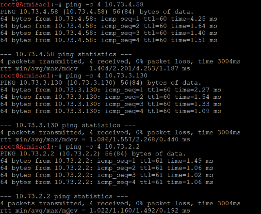

## Soal 4. NAT keluar melalui Gendou

Gendou adalah satu-satunya pintu ke internet. Antarmuka `eth0` diberi alamat `192.168.122.100/24` dengan default route ke `192.168.122.1`, lalu dipasang satu aturan `MASQUERADE` yang hanya cocok untuk prefix internal `10.73.0.0/16` pada antarmuka keluar `eth0`. Karena ada batasan `-s` dan `-o`, hanya trafik internal yang menuju internet yang alamat sumbernya diterjemahkan. Trafik antar-LAN tidak melewati `eth0`, jadi alamat asli pengirim tetap dipakai. Aturan ini juga tidak bergantung pada nomor antarmuka internal, sehingga aman kalau alamat NAT1 berubah. DNS diarahkan ke `8.8.8.8` dan `1.1.1.1` agar node bisa me-resolve nama domain.

```bash
# Gendou
ip addr add 192.168.122.100/24 dev eth0
ip link set eth0 up
ip route add default via 192.168.122.1 dev eth0

echo "nameserver 8.8.8.8" > /etc/resolv.conf
echo "nameserver 1.1.1.1" >> /etc/resolv.conf

iptables -t nat -A POSTROUTING -s 10.73.0.0/16 -o eth0 -j MASQUERADE

ping -c 3 8.8.8.8
ping -c 3 deb.debian.org
iptables -t nat -L POSTROUTING -v -n
```

Pengujian dilakukan dari Gendou, Lilith, dan Armisael dengan IP serta gateway sementara. Ketiganya berhasil menjangkau `8.8.8.8` dan me-resolve `deb.debian.org`. Gendou menjawab dengan `ttl=112`, Lilith `ttl=109`, dan Armisael `ttl=110`. Selisih TTL itu sesuai jumlah hop, Lilith tiga router di bawah Gendou dan Armisael dua router di bawah Gendou. Counter aturan `MASQUERADE` juga bertambah, yang berarti paket internal benar-benar melewati aturan tersebut.

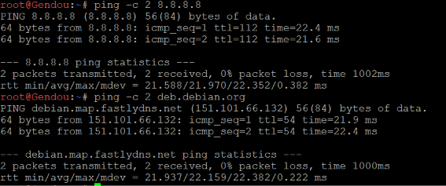
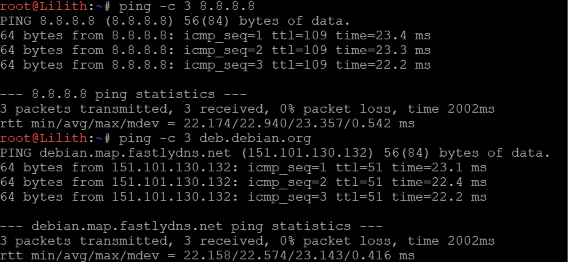
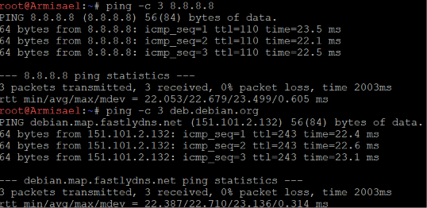

## Soal 5. Firewall Gendou, keluar boleh masuk tidak

Kebijakan bawaan diubah menjadi `DROP` untuk `INPUT` dan `FORWARD`, sedangkan `OUTPUT` tetap `ACCEPT`. Setelah itu dibuka lima pengecualian. Urutannya penting karena iptables membaca aturan dari atas ke bawah.

| Kebutuhan | Aturan | Keterangan |
| --- | --- | --- |
| (a) koneksi yang sudah ada | `-A INPUT -m state --state ESTABLISHED,RELATED -j ACCEPT` dan sama untuk `FORWARD` | Balasan dari internet harus boleh masuk, tanpa ini NAT tidak bekerja |
| (b) internal ke internet | `-A FORWARD -s 10.73.0.0/16 -o eth0 -j ACCEPT` | Hanya arah keluar, jadi koneksi baru dari NAT1 tetap ditolak |
| (c) antar-LAN | `-A FORWARD -s 10.73.0.0/16 -d 10.73.0.0/16 -j ACCEPT` | Satu aturan cukup untuk dua arah karena pengirim dan tujuan sama-sama internal |
| (d) internal ke Gendou | `-A INPUT -s 10.73.0.0/16 -j ACCEPT` | Node internal tetap bisa menjangkau Gendou |
| loopback dan DHCP | `-A INPUT -i lo -j ACCEPT` dan `-A INPUT -i eth0 -p udp --sport 67 --dport 68 -j ACCEPT` | `lo` selalu dibutuhkan, balasan DHCP dari NAT1 masuk ke `INPUT` |

```bash
# Gendou, gendo.sh
sysctl -w net.ipv4.ip_forward=1

iptables -F
iptables -X
iptables -P INPUT DROP
iptables -P FORWARD DROP
iptables -P OUTPUT ACCEPT

iptables -A INPUT -i lo -j ACCEPT
iptables -A INPUT -i eth0 -p udp --dport 68 --sport 67 -j ACCEPT
iptables -A INPUT -m state --state ESTABLISHED,RELATED -j ACCEPT
iptables -A FORWARD -m state --state ESTABLISHED,RELATED -j ACCEPT
iptables -A FORWARD -s 10.73.0.0/16 -o eth0 -j ACCEPT
iptables -A FORWARD -s 10.73.0.0/16 -d 10.73.0.0/16 -j ACCEPT
iptables -A INPUT -s 10.73.0.0/16 -j ACCEPT

iptables -t nat -F POSTROUTING
iptables -t nat -A POSTROUTING -s 10.73.0.0/16 -o eth0 -j MASQUERADE
```

`iptables -S` menampilkan kebijakan `DROP` pada `INPUT` dan `FORWARD`, `ACCEPT` pada `OUTPUT`, serta sembilan aturan seperti pada tabel. Armisael tetap mendapat balasan 4 dari 4 paket dari `8.8.8.8` dengan `ttl=110`, dan ping antar-LAN ke Lilith juga berhasil dengan `ttl=60`. Artinya soal 2 sampai 4 tidak rusak oleh firewall.


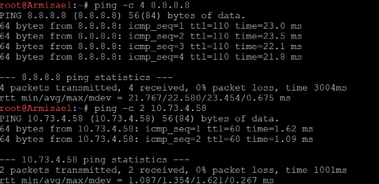

## Soal 6. Alamat statis dan gateway untuk para pilot

Node non-router diberi alamat statis dan gateway sesuai glosarium. Gateway memakai alamat pertama yang bisa dipakai pada segmen, sedangkan host diisi berurutan mulai alamat kedua. Konfigurasi ditulis di `/etc/network/interfaces` supaya bertahan setelah restart.

| Node | Alamat | Gateway |
| --- | --- | --- |
| Quarters | `10.73.0.2/23` | `10.73.0.1` |
| Comm-Net | `10.73.2.2/24` | `10.73.2.1` |
| Hangar-Crew | `10.73.3.2/25` | `10.73.3.1` |
| Sachiel | `10.73.3.130/26` | `10.73.3.129` |
| Pen-Pen | `10.73.3.194/27` | `10.73.3.193` |
| Medic-Bay | `10.73.3.195/27` | `10.73.3.193` |
| Relay-Node | `10.73.3.226/27` | `10.73.3.225` |
| Garden-Staff | `10.73.4.2/28` | `10.73.4.1` |
| Dock-Crew | `10.73.4.18/28` | `10.73.4.17` |
| Entry-Plug | `10.73.4.34/29` | `10.73.4.33` |
| Dummy-Plug | `10.73.4.37/29` | `10.73.4.33` |
| Magi-Casper | `10.73.4.42/29` | `10.73.4.41` |
| Magi-Balthasar | `10.73.4.43/29` | `10.73.4.41` |
| Magi-Melchior | `10.73.4.44/29` | `10.73.4.41` |
| Unit-01 | `10.73.4.50/29` | `10.73.4.49` |
| Unit-02 | `10.73.4.51/29` | `10.73.4.49` |
| Unit-00 | `10.73.4.52/29` | `10.73.4.49` |
| Lilith | `10.73.4.58/29` | `10.73.4.57` |
| Adam | `10.73.4.59/29` | `10.73.4.57` |
| Zeruel | `10.73.4.66/29` | `10.73.4.65` |
| Armisael | `10.73.4.67/29` | `10.73.4.65` |
| Radar-Array | `10.73.4.74/29` | `10.73.4.73` |
| Archive-Vault | `10.73.4.82/30` | `10.73.4.81` |
| Spy | `10.73.4.86/30` | `10.73.4.85` |
| Tokyo3-Core | `10.73.4.90/30` | `10.73.4.89` |

Pada segmen Cage, alamat Misato sebelumnya masih tersalin dari Mari sehingga gateway `10.73.4.49` belum ada pemiliknya. Alamat Misato dibetulkan menjadi `10.73.4.49/29` pada `eth0` dan `10.73.4.114/30` pada `eth1`, lalu Unit-01 dipasangi alamat permanen.

```bash
# Misato
ip addr add 10.73.4.114/30 dev eth1
ip link set eth1 up
ip addr flush dev eth0
ip link set eth0 down
ip link set eth0 up
ip addr add 10.73.4.49/29 dev eth0

# Unit-01
ip neigh flush all
arping -c 3 -I eth0 10.73.4.49
ip addr flush dev eth0
ip link set eth0 down
ip link set eth0 up
ip addr add 10.73.4.50/29 dev eth0
ip route replace default via 10.73.4.49

ping -c 4 10.73.4.49
ip -br a
```

`arping` dipakai untuk memperbarui entri neighbor gateway setelah alamat berubah. Hasilnya Unit-01 memakai `10.73.4.50/29` dan ping ke gateway `10.73.4.49` dijawab 4 dari 4 paket.

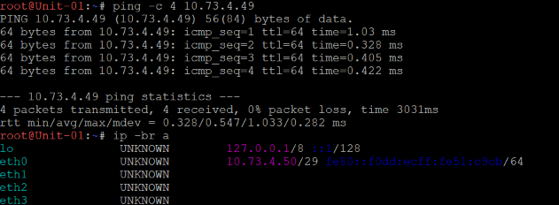

## Soal 7. Menghidupkan MAGI

Casper, Balthasar, dan Melchior berada di segmen `10.73.4.40/29` di bawah Fuyutsuki. Pada tiap node dipasang `iptables` dan `netcat-traditional` lewat `/root/<nama>.sh`, lalu listener dinyalakan sesuai port glosarium. Casper dan Melchior melayani port `5000`, Balthasar melayani `5000` dan `5001`. Opsi `-k` membuat `nc` tetap mendengarkan setelah satu koneksi selesai.

```bash
# Magi-Casper, /root/casper.sh
apt-get update
apt-get install -y iptables netcat-traditional
nc.traditional -l -p 5000 -k &

# Magi-Balthasar, /root/balthasar.sh
apt-get update
apt-get install -y iptables netcat-traditional
nc.traditional -l -p 5000 -k &
nc.traditional -l -p 5001 -k &

# Magi-Melchior, /root/melchior.sh
apt-get update
apt-get install -y iptables netcat-traditional
nc.traditional -l -p 5000 -k &

# Lilith
echo "Pesan dari Lilith untuk Casper" | nc 10.73.4.42 5000
echo "Pesan dari Lilith untuk Balthasar (5000)" | nc 10.73.4.43 5000
echo "Pesan dari Lilith untuk Balthasar (5001)" | nc 10.73.4.43 5001
echo "Pesan dari Lilith untuk Melchior" | nc 10.73.4.44 5000
```

Pesan dari Lilith tampil di sisi penerima. Casper menerima `Pesan untuk Casper` pada port 5000, Balthasar menerima `Pesan untuk Balthasar 5001` pada port 5001 dan `Pesan dari Lilith untuk Balthasar (5000)` pada port 5000, sedangkan Melchior menerima `Pesan dari Lilith untuk Melchior`. Dua port pada Balthasar berjalan bersamaan.

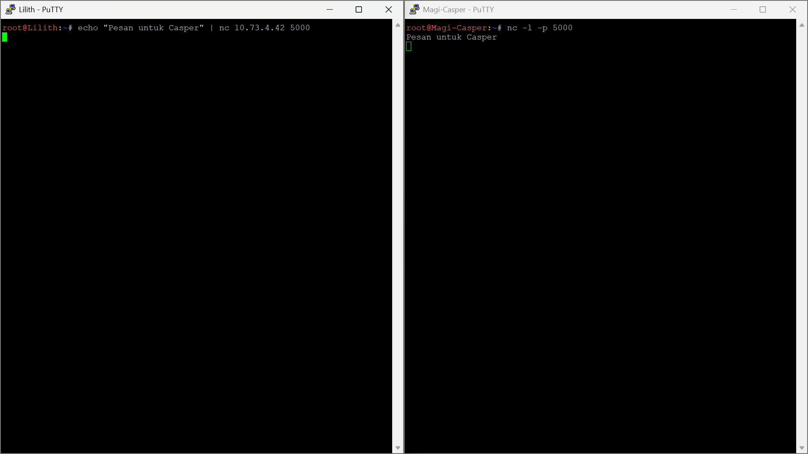
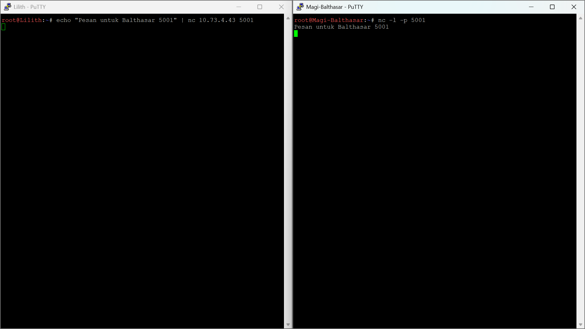
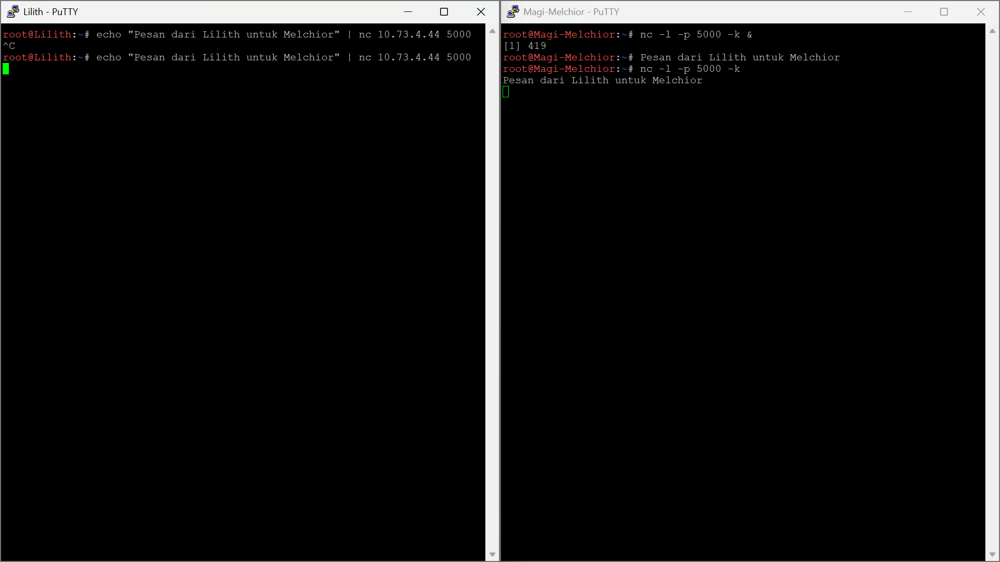
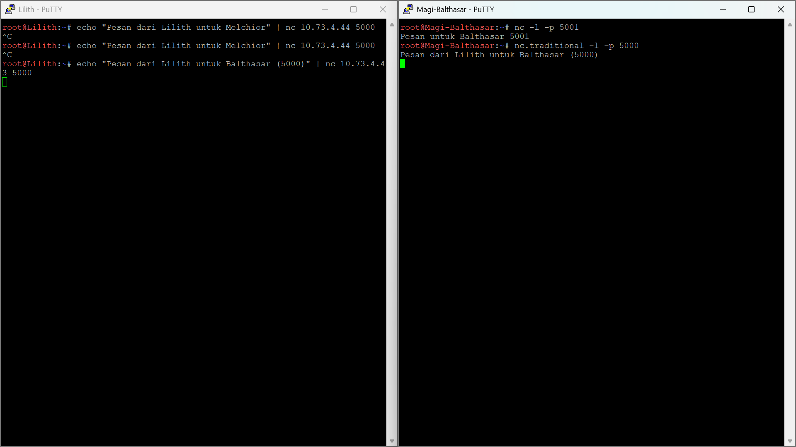

## Soal 8. Kondisi normal Pen-Pen dan Tokyo3-Core

Pen-Pen `10.73.3.194` dan Tokyo3-Core `10.73.4.90` disiapkan sebagai calon sasaran SEELE, jadi keduanya harus melayani lebih dulu agar kondisi normalnya tercatat. Keduanya menjalankan loop `nc -l -p 80 -q 1`. Opsi `-q 1` menutup koneksi satu detik setelah input selesai, lalu `while true` langsung memasang listener lagi. Tokyo3-Core menambah port `8080` dengan balasan `syifa imutz`.

```bash
# Pen-Pen, /root/penpen.sh
echo "nameserver 8.8.8.8" > /etc/resolv.conf
apt-get update
apt-get install -y netcat-traditional iptables
pkill -9 nc 2>/dev/null

while true; do
    echo "Welcome to Pen-Pen" | nc -l -p 80 -q 1
done &

# Tokyo3-Core, /root/tokyo.sh
echo "nameserver 8.8.8.8" > /etc/resolv.conf
apt-get update
apt-get install -y netcat-traditional iptables
pkill -9 nc 2>/dev/null

while true; do
    echo "Welcome to Tokyo3-Core" | nc -l -p 80 -q 1
done &

while true; do
    echo "syifa imutz" | nc -l -p 8080 -q 1
done &
```

```bash
# Lilith
nc 10.73.3.194 80
nc 10.73.4.90 80
nc 10.73.4.90 8080
nc -zv 10.73.3.194 22
nc -zv 10.73.4.90 22
```

Port 80 Pen-Pen menjawab `Welcome to Pen-Pen`, port 80 Tokyo3-Core menjawab `Welcome to Tokyo3-Core`, dan port 8080 menjawab `syifa imutz`. Port 22 pada kedua node dijawab `Connection refused` karena tidak ada proses yang mendengarkan. Kernel langsung mengirim RST, jadi koneksi gagal seketika dan tidak menggantung.

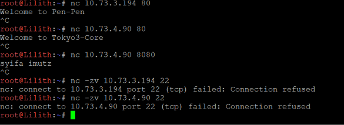

## Soal 9. Sabotase routing di Shigeru

Lilith tidak mendapat balasan dari Armisael. Empat paket dikirim, tidak ada yang diterima, dan tidak muncul pesan error. Di sisi lain Armisael masih bisa ping gateway-nya sendiri `10.73.4.65`. Gejala ini menunjukkan masalahnya ada di tengah jalur, bukan pada host tujuan.

Setelah `break_routing.sh` dijalankan di Shigeru, ditemukan empat perubahan yang saling menutupi.

1. `net.ipv4.ip_forward` diubah menjadi `0`, sehingga Shigeru berhenti meneruskan paket padahal ia satu-satunya jalan ke segmen Monolith.
2. Default route diganti ke gateway yang salah, bukan Gendou `10.73.4.93`, sehingga paket tanpa rute spesifik keluar ke arah yang tidak bisa mengembalikan paket.
3. Dua rute `blackhole` ditambahkan untuk `10.73.4.56/29` (Dogma) dan `10.73.4.64/29` (Monolith). Tipe `blackhole` membuang paket tanpa mengirim ICMP, jadi pengirim hanya melihat timeout.
4. `ip rule` prioritas 90 dengan `iif eth0 lookup 100` memaksa paket yang masuk dari LAN Monolith mencari rute di tabel 100 yang kosong, sehingga jalur balik hilang.

Jalur balik Armisael ke Lilith harus melewati Shigeru, Gendou, Fuyutsuki, dan Toji. Karena Shigeru berhenti meneruskan paket, komunikasi putus di kedua arah.

Armisael tetap bisa ping gateway-nya karena `10.73.4.65` berada di segmen yang sama. Paket dikirim langsung lewat ARP dan diterima antarmuka Shigeru secara lokal, tanpa melewati forwarding atau tabel routing. Kemampuan ini justru membuktikan masalahnya ada pada fungsi routing Shigeru, bukan pada kabel atau antarmuka.

```bash
# Shigeru, shigeru.sh
sysctl -w net.ipv4.ip_forward=1

ip rule del iif eth0 lookup 100 priority 90 2>/dev/null
ip route flush table 100 2>/dev/null

ip route del blackhole 10.73.4.72/29 2>/dev/null
ip route del blackhole 10.73.4.64/29 2>/dev/null

ip route replace default via 10.73.4.93 dev eth2

ip route add 10.73.4.72/29 via 10.73.4.154 dev eth1 2>/dev/null
```

Setelah perbaikan, ping Lilith ke Armisael kembali normal dengan 4 dari 4 paket, `0% packet loss`, `ttl=60`, dan waktu di bawah 1 ms. Nilai `ttl=60` berarti balasan menempuh empat router, jadi jalurnya sudah utuh.

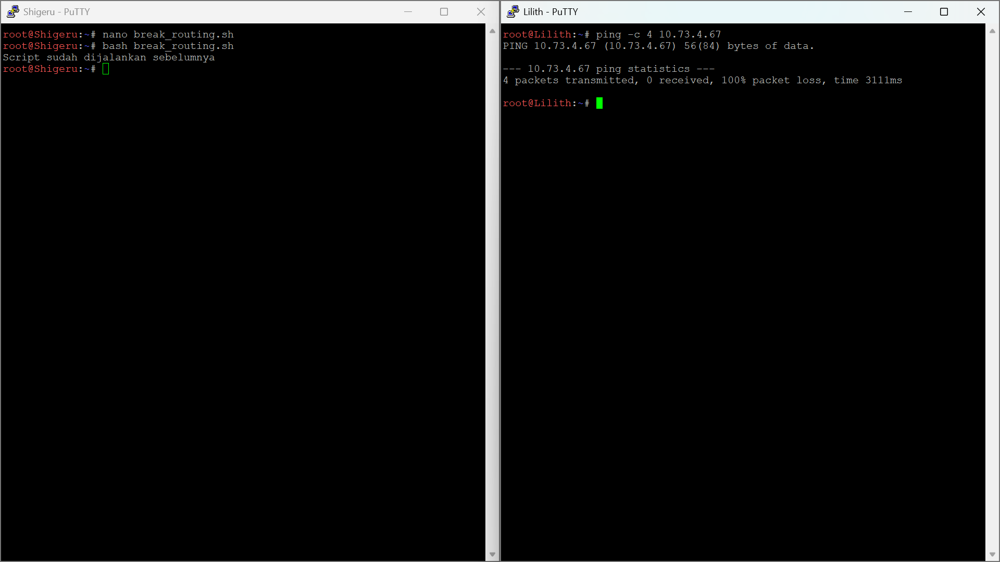
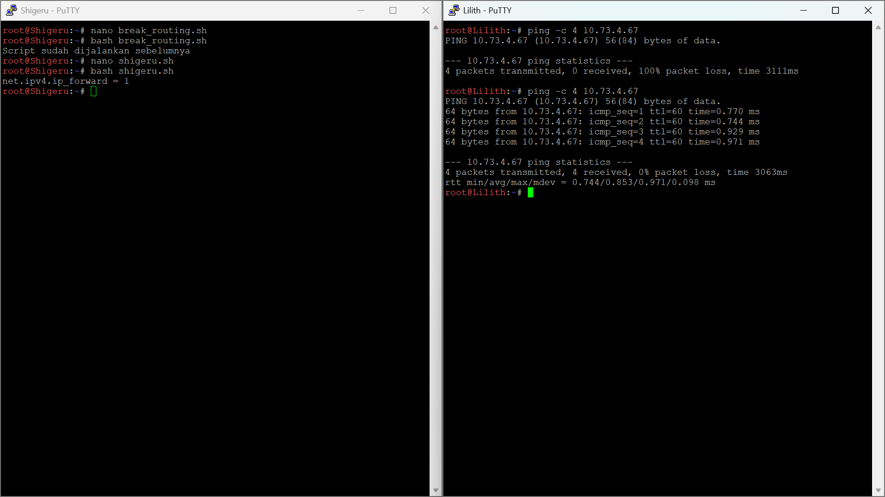

## Soal 10. Sabotase NAT di Misato dan Gendou

Unit-01 di Cage tidak bisa ping `8.8.8.8`. Sembilan paket dikirim dan tidak ada yang diterima. Sementara itu Spy di Intel tetap normal ke `8.8.8.8`, dan ping Unit-01 ke Lilith juga normal 4 dari 4. Artinya routing internal baik, masalahnya khusus pada jalur keluar Cage.

Penyebab pertama ada di Misato. `break_nat.sh` menambahkan aturan SNAT pada chain `POSTROUTING`.

```bash
iptables -t nat -A POSTROUTING -s 10.73.4.48/29 ! -d 10.73.0.0/16 -o eth1 -j SNAT --to-source 172.31.99.1
```

Semua paket dari Cage yang keluar lewat `eth1` menuju luar `10.73.0.0/16` diubah alamat sumbernya menjadi `172.31.99.1`, alamat yang tidak ada di topologi. Paket tetap sampai di Gendou dan diteruskan ke internet, tetapi saat balasan kembali, Gendou harus meneruskannya ke `172.31.99.1` dan alamat itu tidak punya rute. Balasan pun dibuang.

Saat pertama dijalankan, skrip menolak bekerja dengan pesan `Default route belum ada. Selesaikan soal 2 sampai 4 dulu.` karena Misato belum punya default route. Setelah `ip route add default via 10.73.4.113` dipasang, skrip berjalan dan mencetak `Script sudah dirusak`.

Penyebab kedua ada di Gendou. Skrip yang sama menyisipkan `RETURN` pada urutan pertama `POSTROUTING`.

```bash
iptables -t nat -I POSTROUTING 1 -s 10.73.4.64/29 -o eth0 -j RETURN
```

Aturan ini membuat paket dari `10.73.4.64/29` keluar dari chain sebelum mencapai `MASQUERADE`, sehingga alamatnya tidak diterjemahkan. Pada tabel nat yang terekam, aturan ini menunjuk subnet Monolith dan counternya masih `0` paket.

Cage terdampak karena aturan SNAT hanya mencocokkan `-s 10.73.4.48/29`. Spy berada di `10.73.4.84/30` di bawah Kaji, tidak cocok dengan aturan itu, dan tidak melewati Misato. Ping Cage ke Lilith juga tetap normal karena aturan SNAT punya syarat `! -d 10.73.0.0/16`, jadi trafik antar-LAN tidak diterjemahkan.

Alamat sumber diterjemahkan di dua titik. Misato mengubahnya menjadi `172.31.99.1` yang tidak valid, lalu Gendou mengubahnya menjadi alamat NAT1 `192.168.122.100` lewat `MASQUERADE`. Inti masalahnya ada pada terjemahan di Misato, karena setelah itu Gendou tidak mungkin mengembalikan paket ke alamat asal.

```bash
# Misato, fix_nat.sh
while iptables -t nat -D POSTROUTING -s 10.73.4.48/29 ! -d 10.73.0.0/16 -o eth1 -j SNAT --to-source 172.31.99.1 2>/dev/null; do :; done
iptables -t nat -L POSTROUTING -n -v --line-numbers

# Gendou, fix_nat.sh
while iptables -t nat -D POSTROUTING -s 10.73.4.48/29 -o eth0 -j RETURN 2>/dev/null; do :; done
iptables -t nat -C POSTROUTING -s 10.73.0.0/16 -o eth0 -j MASQUERADE 2>/dev/null || \
iptables -t nat -A POSTROUTING -s 10.73.0.0/16 -o eth0 -j MASQUERADE
iptables -t nat -L POSTROUTING -n -v --line-numbers
```

Setelah perbaikan, chain `POSTROUTING` di Misato kosong. Di Gendou hanya tersisa `MASQUERADE` untuk `10.73.0.0/16` dengan counter 38 paket dan 2.580 byte. Unit-01 kembali mendapat balasan 4 dari 4 paket dari `8.8.8.8` dengan `ttl=110`, sama seperti Spy, dan ping ke Lilith tetap normal.

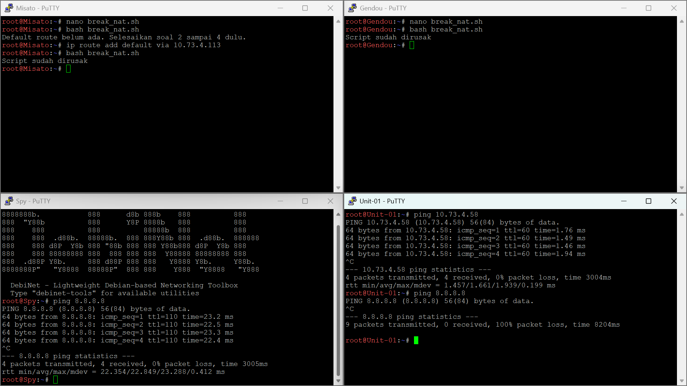
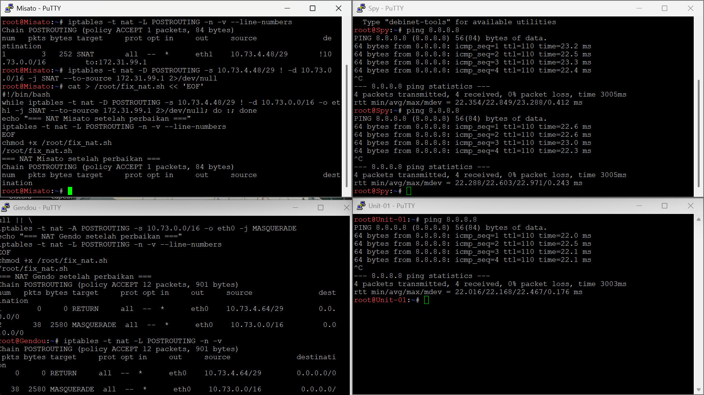
